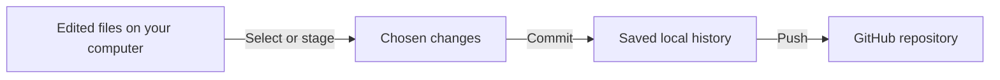

# Upload this project yourself with GitHub Desktop

Revision: 005 | Updated: 25 October 2026 | Windows instructions

Current upload checkpoint: the report's R1-R7 input prompts are complete and
the final local report, profiling supplement and records await commit/push.
Fresh GitHub reads on25 October still show private main at8ba9808, matching local
HEAD. Use [FINAL_UPLOAD_CHECK.md](FINAL_UPLOAD_CHECK.md) for the current checklist
before following Step6. The confirmed extended deadline is25 October2026 at23:59
Australia/Sydney. Initial publication is complete; do not create another repository.

You have now uploaded the MIT licence/records and created a verification clone through Desktop. On 11 October 2026, original workspace, GitHub main and the selected clone matched at `8ba9808` in the private repository `weehaosiah/MMA3001-suspension-modelling`. Its saved-output checks pass; see [clone results](clone_review_v1/CHECK_RESULTS.md). The extra default-directory clone you reported is untouched. Steps 1-5 below remain a reference; do not create another repository or repeat publication. Step 6 is the ongoing update workflow, and step 7 is later final packaging. Keep ongoing edits in the original project folder. The assistant has not operated or visually inspected Desktop; your actions and read-only checks establish the upload/clone. See [SUBMISSION_CHECKLIST.md](SUBMISSION_CHECKLIST.md) for requirements.

## What the words mean

**Git** keeps versions on your computer. **GitHub** hosts a copy online. **GitHub Desktop** provides buttons for using both.

| Term | Meaning in this project |
|---|---|
| Repository, or repo | The project files together with their Git history. |
| Working folder | Files you can open and edit on this computer. |
| Stage / select | Choose the changes to include in the next commit. Desktop uses checkboxes. |
| Commit | A named checkpoint saved locally, with a message, author and identifying code. |
| Push | Send local commits to the online repository. |
| Remote / origin | The online destination; `origin` is its usual short name. |
| Fetch | Find and download remote history without incorporating it into your working branch. |
| Pull | Fetch and incorporate remote changes into your local branch. |
| Branch / main | A line of development; `main` is this project's current branch. |
| Merge | Combine development histories. It does not inherently delete either branch. |
| Clone | Make a new local copy of an online repository, including Git history. |

The everyday sequence is **save a file → select changes → commit locally → push online**. Saving alone creates no Git checkpoint; committing alone uploads nothing. For example, correcting an explanation in the walkthrough becomes an online update only after you commit and push it. See GitHub's [commit workflow](https://docs.github.com/en/desktop/making-changes-in-a-branch/committing-and-reviewing-changes-to-your-project-in-github-desktop) and [remote synchronisation guide](https://docs.github.com/en/desktop/working-with-your-remote-repository-on-github-or-github-enterprise/syncing-your-branch-in-github-desktop).



If you see terminal commands, these mean the same actions. This is a reference;
the Desktop steps below handle them for you. `origin` exists only after the remote
is configured, and these example commands have not been run as part of the lesson.

| Example | Meaning |
|---|---|
| `git status` | Show local file/branch status. A clean working folder can still have unpushed commits. |
| `git add README.md` | Select the saved README changes for the next commit. |
| `git commit -m "Clarify the instructions"` | Save selected changes locally; `-m` supplies the message. |
| `git push origin main` | Send commits from local `main` to the remote named `origin`. |
| `git fetch origin` | Download information/history from that remote without merging it. |
| `git pull` | Fetch and incorporate updates from the branch being followed. |

A **pull request** is a proposal to merge changes, not the same thing as `git pull`.
You do not need one for this direct upload to your own `main` branch.

## 1. Check your school-email account

The connected account is `weehaosiah`; its reported email uses the Monash student domain. On 11 October 2026 you confirmed the school email is verified. That confirmation is recorded as your report; the tool does not expose verified/primary flags. Your school-email instruction is your requirement; the reviewed brief does not specify it. The steps below remain a reference if you need to check or change account settings later.

On GitHub.com, open your profile picture → **Settings → Emails**. Check that your school address is present and verified; use the verification message if needed. Check the primary-address setting too. You can associate a school address with the existing account rather than create another account. Account email and the email attached to local commits are separate settings. [Official email instructions](https://docs.github.com/en/account-and-profile/how-tos/email-preferences/adding-an-email-address-to-your-github-account).

## 2. Open Desktop and add the existing repository

If needed, obtain GitHub Desktop from [its official site](https://desktop.github.com/). On Windows, use **File → Options → Accounts**, sign into GitHub.com through the browser, and confirm the account is `weehaosiah`. The connected account in this chat does not automatically sign Desktop in. [Official sign-in instructions](https://docs.github.com/en/desktop/installing-and-authenticating-to-github-desktop/authenticating-to-github-in-github-desktop).

In Desktop, choose **File → Add local repository → Choose** and select:

```text
C:\Users\dedvu\OneDrive\Documents\MMA3001 Jupiter notebooks
```

Click **Add repository**. Select this whole root folder, which contains both `Project_Setup` and `Suspension_Model`; choosing only the latter loses the repository root. If Desktop proposes creating a repository, recheck the folder before continuing. This project already has Git history, so no new initialisation is needed. [Official add instructions](https://docs.github.com/en/desktop/adding-and-cloning-repositories/adding-a-repository-from-your-local-computer-to-github-desktop).

The hidden `.git` folder holds local history. Keep it intact. Publishing through Git transfers that history; dragging files into GitHub's web uploader does not preserve the existing commits.

## 3. Set your identity for future commits

Select this repository, then open **Repository → Repository settings → Git Config → Use a local Git config**. Enter your chosen author name and exact account-associated commit email, then save. Local configuration applies to this project. If you choose your school email, public commits expose it in their metadata; GitHub also offers an account-provided noreply address. The email choice remains yours. [Official configuration instructions](https://docs.github.com/en/desktop/configuring-and-customizing-github-desktop/configuring-git-for-github-desktop).

This changes future authorship only. Preserve existing AI-attributed commits and the AI-use log; do not rewrite them as your own work.

## 4. Review what will be published

Check Desktop's **History** tab for the existing checkpoints. In **Changes**, inspect any new edits before committing them; a clean repository needs no extra commit just to publish.

Expected tracked content includes the root README, `Project_Setup`, and `Suspension_Model` code, tests, saved data/results and documentation. Keep `.gitignore` and `.gitattributes`: they exclude course originals/caches and preserve file bytes needed by recorded checks. Original course PDFs/notebooks and temporary copies must remain excluded. Some preserved environment records contain local Windows paths.

You selected MIT and confirmed the school email is verified on 11 October 2026. The [licence](../LICENSE), using your configured author name `weehaosiah`, is uploaded and verified. The repository remains private, and assessor access still needs checking. Details are in [PUBLICATION_SETUP.md](PUBLICATION_SETUP.md).

## 5. Publish the existing history

Click **Publish repository**. Review these fields:

| Field | Value or decision |
|---|---|
| Name | Proposed: `mma3001-suspension-modelling` |
| Description | MMA3001 quarter-car suspension simulation, numerical verification and machine-learning comparison for full-response peak suspension travel. |
| Keep this code private | Checked means private; unchecked means public. Choose deliberately. |
| Organization | `None` publishes to your personal account. |

For a first upload, confirm the account, then click **Publish Repository**. This creates the online repository and uploads the committed history. Your first upload is now complete and origin is configured; do not remove that connection to repeat this step. [Official publishing instructions](https://docs.github.com/en/desktop/adding-and-cloning-repositories/adding-an-existing-project-to-github-using-github-desktop).

Open the resulting repository on GitHub.com. Verify its owner, visibility, expected folders and latest commit against Desktop's History. Save the actual URL. A private URL alone grants no access: arrange assessor access and verify it before submission. A public repository can be checked while signed out.

## 6. Update it as you work

Save your edits, review **Changes**, and leave checked only the files belonging to that update. Enter a short **Summary**, such as `Clarify the settling-time explanation`, then click **Commit to main**. Click **Push origin** to upload it. Verify the new commit online. [Official commit/push instructions](https://docs.github.com/en/desktop/making-changes-in-a-branch/committing-and-reviewing-changes-to-your-project-in-github-desktop).

If you changed files online or on another computer, use **Fetch origin** to check, then **Pull origin** when updates are available. Read any conflict message before continuing; a conflict means Git needs help combining edits. [Official syncing instructions](https://docs.github.com/en/desktop/working-with-your-remote-repository-on-github-or-github-enterprise/syncing-your-branch-in-github-desktop).

## 7. Prepare the submission copy later

The brief requires an accessible GitHub repository, and separately the written report and a ZIP of a repository clone through Moodle. Follow the current Moodle instructions for where to enter the URL; the brief does not specify the exact field or report file format. The student confirmed25 October that Moodle requires a PDF report and clone ZIP. Uploading to GitHub alone does not complete submission. The [report](../Report_Draft/MMA3001_suspension_report_draft.docx) now contains all R1-R7 inputs and has nine main pages plus references; the [submission PDF](../output/pdf/MMA3001_suspension_report.pdf) is prepared and final personal reading remains.

After the final push, choose **File → Clone repository** in Desktop. Select your uploaded repository or paste its actual URL, then choose a **new, separate folder**, for example `C:\Users\dedvu\Documents\MMA3001_submission_clone`. Never clone over the original workspace. [Official cloning instructions](https://docs.github.com/en/desktop/adding-and-cloning-repositories/cloning-and-forking-repositories-from-github-desktop).

Check the clone's files and History against the final online commit. In Windows File Explorer, right-click the cloned folder and choose **Compress to ZIP file** (or **Send to → Compressed (zipped) folder**, depending on Windows). We recommend keeping the hidden `.git` folder inside the archive to preserve history, and inspecting the ZIP to confirm it is present; enable hidden items when inspecting the clone. The brief requires a zipped clone but does not separately name `.git`; retaining it is our packaging recommendation, subject to any later Moodle instructions. GitHub's ordinary **Download ZIP** is a file snapshot without the complete history, so it is different from zipping your clone. [Official archive explanation](https://docs.github.com/en/repositories/working-with-files/using-files/downloading-source-code-archives).

Do not ZIP the mixed OneDrive workspace: `.gitignore` does not filter a manually created ZIP. Keep course originals out of the submission clone. Strict audits require separately obtained course sources and the recorded environment; read [REPRODUCING.md](../Suspension_Model/REPRODUCING.md) before attempting them. The existing checks do not establish a fresh installation or universal portability.

The initial instructions were checked against official GitHub documentation on 7 October 2026; relevant pages were revisited during guided upload/cloning and the 11 October brief audit. Commit, syncing and cloning pages were rechecked on25 October. Publication, MIT upload and a verification clone are confirmed. That verification copy now contains four restored, ignored course sources; do not ZIP it for submission. The final clean clone, ZIP and submission remain future work. The deadline is the student's confirmed extension: **25 October 2026 at 23:59 Australia/Sydney**; the brief refers to the Unit Overview Spreadsheet for dates.
