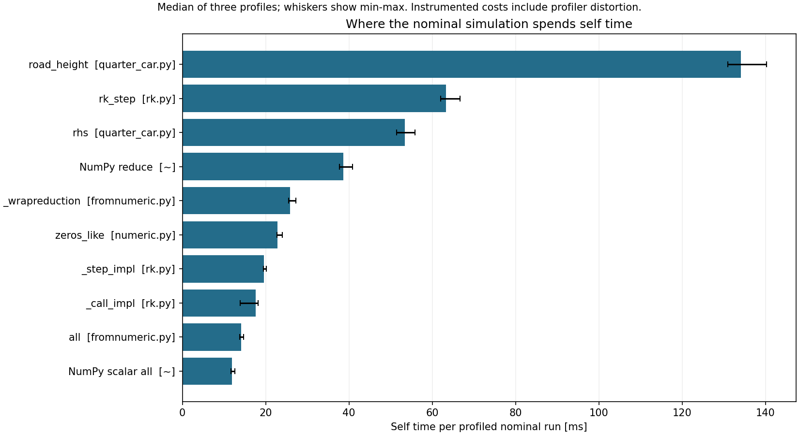

# Nominal profiling: actual results

Completed 12 October 2026. Working performance evidence, not assessed report prose.

Seven repetitions of one existing nominal setup: one warmup and three alternating unprofiled/profiled pairs. No new dataset rows or ML calls.

## Checks

| Check | Actual outcome |
|---|---|
| seven_completed_integrations | PASS |
| exact_saved_physics_and_work | PASS |
| expected_profile_call_counts | PASS |
| numerical_pools_one_thread | PASS |
| protected_files_unchanged | PASS |

All 120 previously existing protected scientific/course files remain byte-identical. All seven non-timing summaries exactly equal the saved nominal baseline, including 6196 derivative evaluations each. Total: 43372 evaluations and 14 solver segments. Raw settling status stays `candidate`; earlier refinement established the nominal resolved result.

Thirteen new focused bookkeeping tests passed in 0.90 s; the old 433-test suite was not rerun. Saved-profile audit passes without a new solve. See TEST_RESULTS.md for test scope and the initial temporary-directory failure.

## Wall time and instrumentation

| Mode | Observations | Median [ms] | Minimum [ms] | Maximum [ms] |
|---|---:|---:|---:|---:|
| unprofiled | 3 | 413.608100 | 394.276200 | 427.101500 |
| profiled | 3 | 524.978600 | 506.943400 | 549.411300 |

| Pair | Execution order | Profiled / unprofiled wall time |
|---|---|---:|
| 1 | unprofiled then profiled | 1.328338 |
| 2 | profiled then unprofiled | 1.331500 |
| 3 | unprofiled then profiled | 1.186939 |

Median paired ratio: **1.328338**. This includes profiler overhead and timing noise, not a performance improvement. Warmup (425.557 ms) is excluded from these statistics.

The earlier nine-case benchmark and today's nominal full-diagnostic measurements have different workload/conditions. Their times must not be combined into a regression or speedup claim. Background OS/user load was not comprehensively controlled; three observations are a limited local sample.

## Largest self-time contributors

Self time excludes called functions. Percentages are per-profile shares, then summarised by their median; medians need not add to 100%.

| Function identity | Median calls | Median self time [ms] | Median self share [%] |
|---|---:|---:|---:|
| project/quarter_car.py:77 road_height | 6197 | 134.148 | 25.56 |
| packages/scipy/integrate/_ivp/rk.py:14 rk_step | 1032 | 63.253 | 12.14 |
| project/quarter_car.py:92 rhs | 6196 | 53.430 | 10.17 |
| ~:0 <method 'reduce' of 'numpy.ufunc' objects> | 12419 | 38.642 | 7.43 |
| packages/numpy/core/fromnumeric.py:71 _wrapreduction | 12417 | 25.868 | 4.96 |
| packages/numpy/core/numeric.py:67 zeros_like | 6197 | 22.831 | 4.37 |
| packages/scipy/integrate/_ivp/rk.py:111 _step_impl | 1027 | 19.521 | 3.72 |
| packages/scipy/integrate/_ivp/rk.py:560 _call_impl | 1027 | 17.629 | 3.31 |
| packages/numpy/core/fromnumeric.py:2421 all | 12404 | 14.155 | 2.70 |
| ~:0 <method 'all' of 'numpy.generic' objects> | 6196 | 11.917 | 2.29 |

## Physical call paths (overlapping cumulative time)

Cumulative time includes callees. These rows overlap: simulate calls the solver, which calls rhs, which calls road_height. Do not add their shares.

| Function | Median cumulative [ms] | Median share [%] | Share range [%] |
|---|---:|---:|---:|
| simulate | 476.766 | 90.88 | 90.82-92.32 |
| rhs | 333.191 | 63.58 | 63.47-64.35 |
| road_height | 222.816 | 42.53 | 42.45-43.12 |
| summarise | 47.271 | 9.00 | 7.56-9.01 |
| state_at | 46.274 | 8.82 | 7.42-8.84 |
| settling_candidate | 0.189 | 0.03 | 0.03-0.04 |
| contact_force | 0.087 | 0.02 | 0.01-0.02 |
| post_bump_energy | 0.070 | 0.01 | 0.01-0.03 |

## Interpretation and decision

Most instrumented time lies in advancing the motion, with a smaller part evaluating the saved trajectory and diagnostics. RK45 repeatedly asks rhs for velocities/accelerations. rhs obtains the road height at each stage; one additional vector road-height call is used by the contact check. This explains 6197 road calls versus 6196 derivative calls.

road_height is the leading self-time function in all three profiles. Static source inspection shows that its general scalar/array interface performs NumPy conversion, finite checks, allocation and masking on each call, including flat-road times. This makes a specialised scalar path a candidate for a separately tested future optimisation. The profile does not measure the benefit of that proposed change, and profiler overhead can distort relative Python/native costs.

Decision for this stage: retain the frozen correct implementation, tolerances, precision and diagnostics. Existing validation remains applicable; no speedup is claimed. Any later optimisation should preserve scalar/array behaviour and all physical outputs, be checked separately and be measured without the profiler. Do not tune on the consumed final test.

No memory, FLOPS, arithmetic-intensity or hardware-counter measurement was made. Function-call counts are not operation counts; this evidence cannot classify the workload as compute-bound or bandwidth-bound.

## Reproduce and inspect

Run `python profile_nominal.py audit --output profiling_v1` to check raw saved evidence. Run `python profile_outputs.py --output profiling_v1` to recreate this presentation and plot; neither command solves the model. Run mode is described in [PROFILING_GUIDE.md](../PROFILING_GUIDE.md) and requires a new output folder.

Raw evidence: plan.json, trials.json, three pair_*.prof files, three function JSON tables, three pstats text files, preservation_before/after.json and summary.json. Profiler source hashes and environment are recorded. JSON exports are readable without relying on cross-version binary profiler compatibility.
